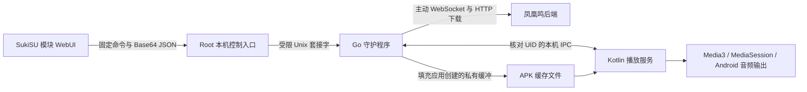

# 凤凰鸣 Android Agent 架构

日期：2026-10-16。版本：`0.2.0-android.1`。已实现 Go 守护、原生播放 APK、模块 WebUI 和打包流程，尚未完成目标手机实测。安装与构建方法见 [Android README](../android/README.md)。

目标设备为 Android 10+、ARM64、已安装 SukiSU Ultra / KernelSU 的华为 Mate。选择模块管理启动和 WebUI，普通应用负责原生播放；本项目不需要 LSPosed Hook。

## 组件

| 组件 | 职责 |
| --- | --- |
| Go 守护 | 后端协议、认证、租约、事件重发、指令去重、下载缓存、日志、制动与播放器连接 |
| Kotlin APK | 普通应用 UID 下的 Media3 播放、音频焦点、媒体通知、进度和音频输出状态 |
| Vue WebUI | 运行总览、待播队列、下载进度、播放控制、一秒跳转、端点配置、日志与制动 |
| 模块脚本 | 环境检查、APK 安装、系统就绪后启动、有限重试、手动停用和卸载 |

Android 实现在独立 Agent 仓库的 `android/` 目录；Windows 的 Node.js、mpv、NSSM 和版本号独立维护。没有新增公网管理端口。

## 协议和播放流程

设备使用后台生成的设备凭证，主动连接后端 `/ws/agents`。继续使用现有 v1 协议、Agent / 播放区身份、epoch、指令期限、ACK、播放事件和事件 ACK。握手声明 `seek` 能力。

收到歌曲后，最多四路下载完整缓存；服务端不正确支持 Range 时，取消分段并重下完整文件。大小和 SHA-256 匹配后才交付播放器。缓存默认 512 MB，单曲上限 200 MB；每次写入前保留至少 256 MB 可用空间。

播放服务在自己的缓存目录创建一个私有缓冲文件。守护只写入这个已存在的文件，核对 UID、普通文件类型和权限，不创建替代文件、不改变其 SELinux 标签。写入后再次核对 SHA-256，APK 自行以只读方式打开。此缓冲最多额外占用一首歌的空间。播放器不接收外部路径或文件描述符，没有网络权限和后端凭证。

本机套接字双方核对 UID；守护还核对已安装 APK 与模块内 APK 的完整文件哈希。配置和日志在 `/data/adb/fenghuangming`，目录权限 0700，控制套接字 0600，只接受 Root 客户端。页面不会读回完整凭证，保存配置后重新连接并保持制动。

播放事件持久化后发送，直到后端确认；指令去重记录保留最近 500 个。旧 epoch、过期指令、错误任务 ID、损坏下载和非整数进度均拒绝。下载完成后再核对任务是否仍有效，防止停止或制动后迟到的下载重新播放。

进度条、输入跳转和加减按钮均以一秒为步长，保留暂停状态；上限为实际时长向下取整后减一秒。页面操作携带当前播放任务 ID，换歌后旧操作失效。

## 保活与制动

模块只在 `service.sh` 阶段等待系统就绪，最多等待两分钟。Go 使用进程锁避免重复运行；退出后逐步延迟恢复，连续失败五次停止重试。APK 使用可见前台服务，声明远程播放待命用途，真正有任务时增加媒体播放用途。

播放器定时报告真实状态，失去后端租约后停止歌曲。后台启动限制、熄屏网络和华为 ROM 的电源管理仍需实机验收；不会自动关闭系统电池管理或修改其他应用。

紧急制动立即阻止后续任务，取消下载，持久化锁定并停止本项目播放。播放器未在限定时间内回应时关闭本机连接并停止自己的 APK。守护离线时，独立控制入口仍可写入制动锁并停止 APK。重启、重连、开机均不解除制动；解除后也不重播旧任务。

手动停止服务、模块禁用与卸载优先于自动恢复。卸载只停止本项目，保留配置和播放 APK，用户可从应用管理单独卸载 APK。模块没有引导或分区操作、KPM、框架注入、全局 SELinux 变更或自动重启手机。

## 发行与验证

发行 ZIP 包含 ARM64 Android PIE、签名 APK、WebUI、模块脚本、第三方声明和逐文件哈希清单。签名私钥与密码仅在开发机的忽略目录中，后续 APK 更新须复用同一私钥。

桌面检查覆盖 Go 状态和协议、下载校验、原生控制状态机、WebUI 类型与界面、APK 签名、ARM64 链接器及包内文件。详细记录见 [验证记录](../android/VERIFICATION.md)。桌面检查不能替代真实音频、SELinux IPC、开机与熄屏测试。

首轮手机验收应使用独立测试设备凭证，确认：安装与停用、WebUI 桥接、默认音频输出、完整播放、一秒跳转、下载中停止、制动后重启、断网租约、耳机 / 蓝牙断开、熄屏和长时间空闲后接歌。只将实际测试过的设备与 ROM 列入兼容记录。

## 官方参考

- [KernelSU 模块 WebUI](https://kernelsu.org/guide/module-webui.html)
- [KernelSU 模块结构](https://kernelsu.org/guide/module.html)
- [SukiSU Ultra](https://sukisu.org/)
- [Android Media3 后台播放](https://developer.android.com/media/media3/session/background-playback)
- [前台服务后台启动限制](https://developer.android.com/develop/background-work/services/fgs/restrictions-bg-start)
- [AOSP 应用 SELinux 规则](https://android.googlesource.com/platform/system/sepolicy/+/refs/heads/main/private/app.te)
